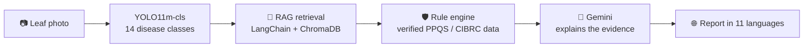

<!-- ═══════════════════════════ HEADER ═══════════════════════════ -->
<p align="center">
  
</p>

<p align="center">
  
</p>

<p align="center">
  
  
  
</p>

---

### `$ whoami`

```python
class Ryan:
    role        = "Final-year Computer Science student · ML engineer in the making"
    focus       = ["Large Language Models", "Computer Vision", "Retrieval-Augmented Generation"]
    llm_stack   = ["SFT", "RLHF", "QLoRA", "RAG", "Prompt Engineering"]
    vision      = ["CNN", "ResNet", "YOLO"]
    toolbox     = ["PyTorch", "NumPy", "Pandas", "Matplotlib", "scikit-learn", "LangChain"]
    hobbies     = ["Web dev", "Android apps"]   # side quests, not the main quest

    def current_status(self):
        return "Training models, reading papers, shipping AI apps 🚀"
```

---

### 🧠 What I Work On

<table>
  <tr>
    <td width="50%" valign="top">
      <h4>🤖 Large Language Models</h4>
      <ul>
        <li>Supervised fine-tuning (<b>SFT</b>)</li>
        <li>Alignment with <b>RLHF</b></li>
        <li>Parameter-efficient tuning (<b>QLoRA</b>)</li>
        <li>LLM apps on Llama 3, DeepSeek and Gemini</li>
      </ul>
    </td>
    <td width="50%" valign="top">
      <h4>👁️ Computer Vision</h4>
      <ul>
        <li><b>CNNs</b> from scratch to transfer learning</li>
        <li><b>ResNet</b> backbones for classification</li>
        <li><b>YOLO</b> (YOLO11) training and evaluation</li>
        <li>Data cleaning, augmentation and error analysis</li>
      </ul>
    </td>
  </tr>
  <tr>
    <td width="50%" valign="top">
      <h4>🔎 Retrieval-Augmented Generation</h4>
      <ul>
        <li>LangChain + ChromaDB vector search</li>
        <li>BGE embeddings over PDFs and tables</li>
        <li><b>Safe-RAG</b>: rule engine checks the facts, the LLM only explains them</li>
      </ul>
    </td>
    <td width="50%" valign="top">
      <h4>📊 Data Science & Tooling</h4>
      <ul>
        <li>NumPy, Pandas, Matplotlib, Seaborn</li>
        <li>scikit-learn for metrics and baselines</li>
        <li>Streamlit, Docker and Azure for deployment</li>
      </ul>
    </td>
  </tr>
</table>

---

### 🛠️ Tech Stack

<p align="center">
  
</p>

<p align="center">
  
  
  
  
  
  
  
  <br/>
  
  
  
  
  
  
  
</p>

---

### 🚀 Featured Project: Plant Disease Safe-RAG Advisory

> **[plant-disease-safe-rag-advisory](https://github.com/RyanK-glitch/plant-disease-safe-rag-advisory)**: my final-year dissertation project. Upload a photo of a leaf to get a diagnosis, treatment advice checked against Indian government records, and a report in plain language in 11 languages.



| Metric | Value |
|:--|:--|
| 🎯 Top-1 accuracy | **97.94 %** |
| 🎯 Top-5 accuracy | **100 %** |
| 📉 Validation loss | 0.075 |
| 🖼️ Dataset | 11,666 train / 3,550 val images |
| 🌾 Crops | Maize · Potato · Rice · Wheat |

---

### 💬 LLM Applications

| Project | What it does | Model |
|:--|:--|:--|
| 🩺 [medical-ai-chatbot](https://github.com/RyanK-glitch/medical-ai-chatbot) | Medical & health information assistant | Llama 3.3 70B · Groq |
| 🎓 [Assignment-Helper](https://github.com/RyanK-glitch/Assignment-Helper) | Rubric-aligned academic workspace | Llama 3.3 70B · Groq |
| 📜 [history-ai-chatbot](https://github.com/RyanK-glitch/history-ai-chatbot) | World history research assistant: my first AI chatbot | Llama 3.3 70B · Groq |
| 🏛️ [Iranian-revolution-ai](https://github.com/RyanK-glitch/Iranian-revolution-ai) | Q&A assistant on the Iranian Revolution | Llama 3.1 8B · Groq |
| 🐋 [Iranian-revolution-bot-with-deepseek-API](https://github.com/RyanK-glitch/Iranian-revolution-bot-with-deepseek-API) | The same assistant built on DeepSeek | DeepSeek Chat · OpenRouter |

<details>
<summary><b>🎮 Hobby projects (web & mobile)</b></summary>
<br/>

| Project | What it is |
|:--|:--|
| 💰 [SpendWise](https://github.com/RyanK-glitch/SpendWise) | Android expense tracker in Java with 185 unit tests |
| 💌 [date-invite](https://github.com/RyanK-glitch/date-invite) | A playful date invitation page that saves answers to SQLite |

</details>

---

### 📈 GitHub Analytics

<p align="center">
  
  
</p>

<p align="center">
  
</p>

<p align="center">
  
</p>

---

<p align="center">
  <code>loss.backward() · optimizer.step() · never stop learning</code>
</p>

<p align="center">
  
</p>
